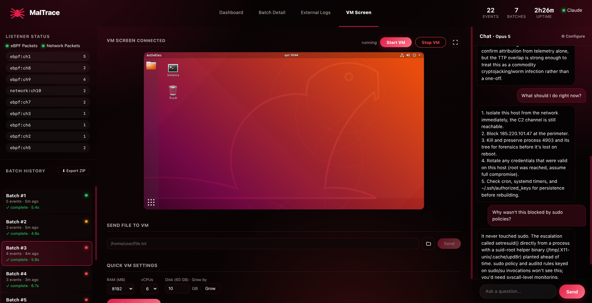

<div align="center">


# Maltrace

### A dynamic malware analysis sandbox with a RAG-powered LLM analyst.

**Detonate a sample in a disposable VM. Watch kernel and network telemetry turn into verdicts in near real time.**

[](https://www.python.org/)
[](#architecture)
[](#telemetry-channels)
[](#architecture)
[](#how-the-analysis-works)
[](#usage)
[](#quick-start)
[](LICENSE)

[Features](#features) · [Quick start](#quick-start) · [Usage](#usage) · [Architecture](#architecture) · [How the analysis works](#how-the-analysis-works) · [Repository layout](#repository-layout) · [Contributing](#contributing) · [License](#license)

</div>

<br />

<div align="center">

</div>

<br />

Maltrace runs a suspicious sample inside a disposable QEMU virtual machine while two independent telemetry channels watch it: **eBPF/bpftrace at the kernel level** inside the guest, and **network capture at the userspace level**. Both streams reach the host, are grouped into 30-second batches, enriched with a RAG knowledge base, and handed to an LLM that classifies each batch as `SAFE`, `SUSPICIOUS` or `THREAT`, with a severity from 1 to 5 and a justification that cites concrete evidence (pid, path, ip:port).

## Features

- **Two telemetry channels.** Nine bpftrace scripts (one per attack pattern) plus a scapy/psutil network supervisor that ties every connection to its process.
- **Isolated transport.** The guest has no management network: every event leaves through encrypted virtio-serial ports, one per detection category.
- **Hybrid RAG.** HyDE query rewriting, dense retrieval with a fine-tuned embedding model, BM25, Reciprocal Rank Fusion and cross-encoder reranking over curated fact sheets.
- **Pluggable LLMs.** Ollama (local), OpenAI-compatible endpoints (OpenAI and Gemini) or Claude, switchable at runtime with token-by-token streaming.
- **Factual consistency check.** IPs, paths, hashes, PIDs, UIDs and ports claimed by the LLM are checked against the raw log, and anything unconfirmed is flagged.
- **External Search (optional).** Public IPs and domains are looked up on AbuseIPDB and VirusTotal, and a fixed assessment is computed in code so the LLM reads a verdict, not raw numbers.
- **MITRE ATT&CK mapping (optional).** Technique IDs are validated against an offline ATT&CK Enterprise base.
- **External Logs.** Paste or load logs of a second sample and analyze them in parallel, fully isolated from the live pipeline.
- **Web dashboard.** Live batches, charts, an embedded noVNC view of the VM, a host terminal, an analyst chat, file transfer into the VM and quick VM settings.
- **Demo mode.** A presentation mode with a prepared attack chain and no malware required.

## Quick start

The fastest way to see Maltrace is the demo mode, which seeds a coherent TeamTNT-style cryptojacking chain and needs no sample and no live telemetry:

```sh
cd virtual_machine
MALTRACE_DEMO=1 ../venv/bin/python3 pipeline_web.py
```

Then open `http://localhost:8080`.

In demo mode the VM screen, Start/Stop VM and the settings panels are real, while the batches, charts and chat are prepared data. Before re-analyzing batches, pick an installed model in **⚙ Configure**, because the default Ollama model may not exist on your machine.

Stop it, including the `websockify` and `ttyd` children:

```sh
pkill -f "[p]ipeline_web.py"; pkill -f "[w]ebsockify"; pkill -f "[t]tyd.*7682"
```

### Real mode

Real mode needs more pieces on the host and in the guest:

- **Host:** Linux, QEMU, a Python environment with `chromadb`, `sentence-transformers`, `rank-bm25` and `tqdm`, `websockify`, a clone of [noVNC](https://github.com/novnc/noVNC) at `virtual_machine/novnc`, and optionally `ttyd` and `libguestfs-tools` (used to auto-mount the shared folder in the guest).
- **Guest:** a Linux VM disk image referenced by `virtual_machine/vm_controller.c`, with `bpftrace`, the nine `.bt` scripts from `modules/07_security/`, `scapy` and `psutil`, and the `guest_monitor` and `supervisor_monitor` agents compiled inside the guest.
- **Knowledge base:** build the vector store from the fact sheets with `python indexer.py`.

Then start the dashboard without `MALTRACE_DEMO` and use **Start VM** in the VM Screen tab. The path to the disk image is specific to each machine, so adjust it in `vm_controller.c`.

## Usage

The dashboard has four tabs.

| Tab | What it does |
|---|---|
| **Dashboard** | Live events per source and port, events over time, and the batch list with a severity dot (green 1, yellow 2-3, red 4-5). |
| **Batch Detail** | Raw events, retrieved RAG category and confidence, the streamed LLM response and the External Search block. |
| **VM Screen** | The real VM framebuffer over noVNC, Start/Stop VM, fullscreen, CPU and memory charts, file transfer into the guest, and RAM/vCPU/disk settings. |
| **External Logs** | Analyze logs pasted or loaded from a file, isolated from the live batches. |

Open **⚙ Configure** to choose the LLM provider and model, set External Search to Disabled, Automatic or Manual, and toggle MITRE ATT&CK mapping. These settings live in memory and reset when the server restarts.

### Sending a file into the VM

The **Send File to VM** card accepts either an absolute path on the host or a file chosen with the native picker. The file lands in `virtual_machine/vm_shared/`, which is shared with the guest over 9p and mounted at `/mnt/shared`. Only that folder is exposed, never your home directory.

### External Search

Reputation lookups run in three modes. **Disabled** is the default. **Automatic** checks up to three indicators per batch and skips known benign infrastructure. **Manual** adds a button to each batch that re-analyzes it with up to five lookups. API keys go in `secrets/` (git-ignored) or in the dashboard panel, where they are never echoed back.

## Architecture

```
┌──────────────────────────── QEMU VM (guest) ─────────────────────────────┐
│  guest_monitor      → 9 bpftrace scripts, one per attack pattern          │
│  supervisor_monitor → supervisor.py (scapy + psutil), network + process   │
│  every stream is encrypted and sent through its own virtio-serial port    │
└────────────────────────────────────┬──────────────────────────────────────┘
                                     │ virtio-serial
┌────────────────────────────────────▼──────────────────────────────────────┐
│                                   Host                                    │
│  vm_controller      → starts and stops the VM, records the serial ports   │
│  host_listener      → decrypts the eBPF ports (ch1-ch9)                   │
│  supervisor_listener→ decrypts the network ports (ch10+)                  │
│  pipeline_web.py    → batching, RAG, LLM, dashboard and SSE               │
└───────────────────────────────────────────────────────────────────────────┘
```

Every detection category has its own virtio-serial port, so an event's origin is known before it reaches the LLM. Serial is the only way out of the guest: there is no management network and no shared folder for telemetry.

### Telemetry channels

- **eBPF (kernel level).** Nine bpftrace scripts cover dangerous syscalls, Docker socket access, fileless execution, kernel module loading, log tampering, suspicious network activity, privilege escalation, sensitive file access and suspicious execution. Each maps one-to-one to a fact sheet in `RAG_docs/`.
- **Network (userspace).** `supervisor.py` captures IP, TCP, UDP, ICMP, DNS and ARP packets and correlates each connection with its process, pid, user and command line. Network events are also recognized by content, so a wrong port classification does not hide them.

## How the analysis works

1. **Ingest.** Listener output becomes tagged events (`[ebpf:...]` or `[network:...]`) and is broadcast to the dashboard over SSE.
2. **Batch.** Every 30 seconds the accumulated events become a batch, of which the last 100 events are analyzed.
3. **Retrieve.** The LLM first rewrites the raw batch into a short list of security actions (HyDE). Dense and BM25 search are fused with Reciprocal Rank Fusion, reranked by a cross-encoder, and reduced to the best chunk per category, with `HIGH`, `MEDIUM` or `LOW` confidence.
4. **Enrich (optional).** External Search adds reputation results for public IPs and domains.
5. **Classify.** The prompt treats each retrieved category as a hypothesis to confirm against the raw log, asks the LLM to correlate `[ebpf]` and `[network]` events from the same process into one causal chain, and returns `VERDICT`, `SEVERITY` and `ANALYSIS`.
6. **Verify.** The consistency check flags any concrete claim that does not appear in the raw log.

### Knowledge base

`RAG_docs/` holds one Markdown fact sheet per attack category. Each follows the same five sections, which `indexer.py` uses as chunk boundaries: **Script Objective**, **Anomaly Patterns**, **Normal Patterns (Common False Positives)**, **Base Criticality Level** and **Suggested Correlation**. The embedding model is a fine-tune of `nomic-embed-text-v1.5` trained for this short format, so the store holds distilled knowledge rather than raw telemetry. Adding a category means writing a new fact sheet with those exact headers and running `indexer.py` again.

## Repository layout

```
virtual_machine/      pipeline_web.py, dashboard.html, QEMU controller, listeners,
                      guest agents and supervisor, noVNC integration, shared folder
RAG_docs/             fact sheets, one per attack category
modules/              bpftrace scripts, grouped by topic (07_security holds the nine used)
mitre_attack/         offline ATT&CK Enterprise technique base
scripts/              ATT&CK index builder and LID-DS dataset tools
log_watcher.py        RAG retriever, HyDE and prompt templates
search_enrichment.py  AbuseIPDB and VirusTotal lookups
attack_mapping.py     ATT&CK ID validation
indexer.py            builds the ChromaDB store
finetune_embeddings.py  fine-tunes the embedding model
eval_*.py, rubric.md  retrieval and verdict evaluation over synthetic batches
```

More detail lives in [`CONTEXTO.md`](CONTEXTO.md) (system walkthrough) and [`MITRE.md`](MITRE.md) (ATT&CK integration and its open decision).

## Contributing

Issues and pull requests are welcome. Keep each change focused on a single behavior, and open an issue first for anything that touches the telemetry transport or the guest agents.

## Safety notes

Maltrace is built to run malware. Use it only on samples and systems you are authorized to analyze, and keep the dashboard off untrusted networks: it binds to `0.0.0.0:8080`, and the VNC bridge on port `6080` gives control of the VM to anyone who can reach it. The embedded host terminal binds to `127.0.0.1` on purpose.

## License

Released under the [PolyForm Noncommercial License 1.0.0](LICENSE). You may use, study and modify Maltrace for noncommercial purposes such as research, but not for commercial or profit-oriented use.
